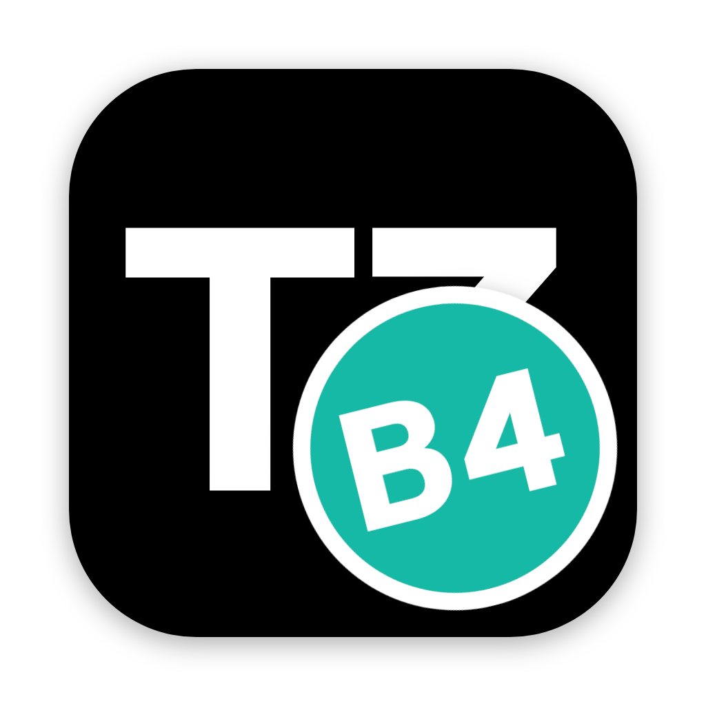

# b4code

b4code is my personal fork of [T3 Code](https://github.com/pingdotgg/t3code), the GUI for coding agents built by the T3 Code team. It's the same app underneath, shamelessly renamed and bent toward how I like to work.

Looking for T3 Code itself? Go to [pingdotgg/t3code](https://github.com/pingdotgg/t3code) or [t3.codes](https://t3.codes). That's the real product, with releases, docs, a mobile app, and people who answer questions. All credit for the app goes to them.

## What this repo is

The code is public and keeps upstream's MIT license. Read it, borrow from it, fork it again.

It isn't a community project. I don't take issues or pull requests, there are no releases, and nothing here goes back upstream. It changes whenever I want something different, and it may break your setup if you run it.

b4code is T3 Code with a new name and a sticker slapped over the T3 icon. That's the whole joke.

## How it stays current

`main` is upstream's `main` with my commits on top. `node fork/b4.ts sync` rebases it onto upstream. Fork code lives in [`fork/`](../fork) when it can, and edits to upstream files stay small, so each rebase has fewer lines to conflict.

## Running it

[`fork/README.md`](../fork/README.md) covers syncing, deploying, and pairing. It's written for my machines, so expect to adapt it.

Upstream's README is still at the [repo root](../README.md), unchanged. Its install instructions get you the official T3 Code, not this fork.
